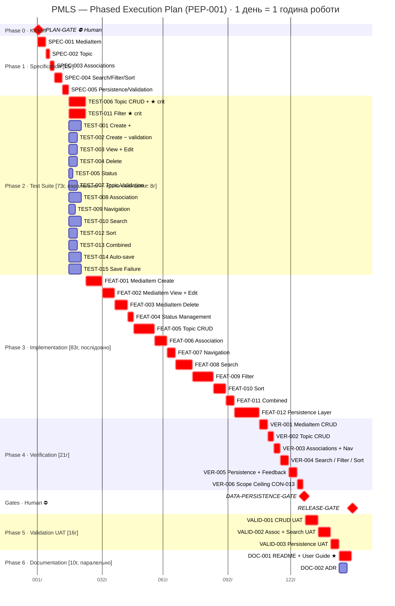

# Phased Execution Plan — Personal Media Library System (PMLS)

**Artifact ID:** PEP-001  
**Source:** docs/jira-decomposition.csv · spec/srs.md v1.0 (SRS-001)  
**Author role:** System Architect / Tech Lead  
**Date:** 2026-10-19  
**Status:** APPROVED

---

## Передумови та принципи планування

Перед описом фаз — три архітектурні рішення, які визначають порядок:

1. **TDD-перший підхід.** Кожен Test-тікет передує своєму Feature. Ніяка реалізація не починається без тестів.
2. **Persistence Layer іде останнім у Feature-ланцюжку, але є критичним блокером.** Всі FEAT-001..011 повинні бути готові до того, як FEAT-012 (Auto-save) інтегрує їх зі сховищем.
3. **Паралелізм у TEST-тікетах.** Всі тести можна писати одночасно — вони незалежні один від одного. Це єдина точка реального паралелізму в проєкті.

---

## Phase 0 — Project Kickoff Gate

**Головна мета:** Офіційно підтвердити що специфікація затверджена і команда може починати роботу.

### Тікети

| Issue ID | Summary | Type |
|---|---|---|
| 1 | PLAN-GATE: Специфікацію затверджено | Gate |

### Prerequisites

- `spec/srs.md` у статусі **Baseline**
- `spec/traceability.md` у статусі **Baseline**
- `docs/jira-decomposition.csv` імпортовано в Jira
- `docs/TRACEABILITY.md` узгоджено

### Work Effort

| Роль | Години |
|---|---|
| Human | 0 (підпис Gate) |
| **Разом** | **0** |

### Definition of Done

- ✅ Людина підписала PLAN-GATE в Jira
- ✅ Всі 46 тікетів мають статус "To Do" у Jira
- ✅ Issue Links між тікетами встановлені
- ✅ CON-013 (Scope Ceiling) задокументований як активне обмеження

---

## Phase 1 — Domain Specification

**Головна мета:** Зафіксувати доменну модель, бізнес-правила та поведінку системи у вигляді специфікацій перед будь-якою реалізацією. Ці артефакти є контрактом між тестами та кодом.

### Тікети

| Issue ID | Summary | Type |
|---|---|---|
| 2 | SPEC-001: Специфікація домену — MediaItem | Specification |
| 3 | SPEC-002: Специфікація домену — Topic | Specification |
| 4 | SPEC-003: Специфікація — Асоціації MediaItem–Topic та Навігація | Specification |
| 5 | SPEC-004: Специфікація — Search Filter Sort та Combined Operations | Specification |
| 6 | SPEC-005: Специфікація — Auto-save Persistence та Validation Feedback | Specification |

> SPEC-001..005 з'єднані лінійно через `Blocks` (кожна блокує наступну). Це не технічна залежність коду — це контроль рев'ю, щоб кожна специфікація перевірялась послідовно. За бажанням можна паралелити SPEC-002..005 якщо рев'юер один і встигає.

### Prerequisites

- ✅ Phase 0 завершена (PLAN-GATE підписаний)

### Work Effort

| Роль | Тікети | Години |
|---|---|---|
| Agent | SPEC-001..005 | 15 |
| **Разом** | | **15** |

### Definition of Done

- ✅ SPEC-001..005 у статусі "Done"
- ✅ Доменна модель MediaItem та Topic задокументована з усіма полями, типами, статусами, правилами нормалізації
- ✅ Правила many-to-many асоціацій, пошуку, фільтрації, сортування, автозбереження описані
- ✅ Жоден артефакт не вводить функціональності поза SRS-001 (CON-013 перевірено)

---

## Phase 2 — Test Suite (паралельна розробка тестів)

**Головна мета:** Написати повний набір тестів для всіх функціональних блоків _до_ початку реалізації. Після цієї фази команда має зелену зону очікувань і червону зону результатів — класичний TDD-старт.

### Тікети

| Issue ID | Summary | Type |
|---|---|---|
| 7 | TEST-001: MediaItem Create (позитивні) | Test |
| 8 | TEST-002: MediaItem Create (негативні / валідація) | Test |
| 9 | TEST-003: MediaItem View та Edit | Test |
| 10 | TEST-004: MediaItem Delete | Test |
| 11 | TEST-005: MediaItem Status Management | Test |
| 12 | TEST-006: Topic CRUD (позитивні) | Test |
| 13 | TEST-007: Topic Validation (негативні) | Test |
| 14 | TEST-008: Асоціація MediaItem–Topic (обидві сторони) | Test |
| 15 | TEST-009: Навігація Topic↔MediaItem | Test |
| 16 | TEST-010: Search | Test |
| 17 | TEST-011: Filter | Test |
| 18 | TEST-012: Sort | Test |
| 19 | TEST-013: Combined Search+Filter+Sort | Test |
| 20 | TEST-014: Auto-save та Persistence | Test |
| 21 | TEST-015: Save Failure Notification | Test |

> **Всі 15 тестових тікетів паралельні між собою.** Якщо є кілька розробників — можна розподілити довільно. Мінімальний час фази при повному паралелізмі = найдовший одиночний тест = 8 год (TEST-006 або TEST-011).

### Prerequisites

- ✅ Phase 1 завершена (SPEC-001..005 у статусі "Done")
- ✅ Технологічний стек вибраний (тест-фреймворк відомий)

### Work Effort

| Роль | Тікети | Години |
|---|---|---|
| Agent | TEST-001..015 | 73 |
| **Разом** | | **73** |

### Definition of Done

- ✅ Всі 15 TEST-тікетів у статусі "Done"
- ✅ Тести запускаються та **провалюються** (red) — реалізації ще немає
- ✅ Покрито: AC-001..051, BDD-001..070, VR-001..011
- ✅ Тести на save failure (TEST-015) мають механізм ін'єкції збою на рівні тест-середовища

---

## Phase 3 — Feature Implementation (послідовна реалізація)

**Головна мета:** Реалізувати весь функціональний код у порядку залежностей доменної моделі. Кожен FEAT-тікет стартує тільки після того як відповідний TEST-тікет завершений.

### Тікети та послідовність

```
FEAT-001 → FEAT-002 → FEAT-003 → FEAT-004 → FEAT-005
                                               ↓
FEAT-006 → FEAT-007 → FEAT-008 → FEAT-009 → FEAT-010 → FEAT-011 → FEAT-012
```

| Issue ID | Summary | Type | Залежить від | Год. |
|---|---|---|---|---|
| 22 | FEAT-001: MediaItem Create | Feature | TEST-001, TEST-002 | 8 |
| 23 | FEAT-002: MediaItem View та Edit | Feature | TEST-003, FEAT-001 | 6 |
| 24 | FEAT-003: MediaItem Delete | Feature | TEST-004, FEAT-002 | 6 |
| 25 | FEAT-004: MediaItem Status Management | Feature | TEST-005, FEAT-003 | 3 |
| 26 | FEAT-005: Topic CRUD | Feature | TEST-006, TEST-007, FEAT-004 | 10 |
| 27 | FEAT-006: MediaItem–Topic Association | Feature | TEST-008, FEAT-005 | 6 |
| 28 | FEAT-007: Navigation (Topic↔MediaItem) | Feature | TEST-009, FEAT-006 | 4 |
| 29 | FEAT-008: Search | Feature | TEST-010, FEAT-007 | 8 |
| 30 | FEAT-009: Filter | Feature | TEST-011, FEAT-008 | 10 |
| 31 | FEAT-010: Sort | Feature | TEST-012, FEAT-009 | 6 |
| 32 | FEAT-011: Combined Search+Filter+Sort | Feature | TEST-013, FEAT-010 | 4 |
| 33 | FEAT-012: Auto-save та Persistence Layer | Feature | TEST-014, TEST-015, FEAT-011 | 12 |

### Prerequisites

- ✅ Phase 2 завершена (всі TEST-тікети "Done")
- ✅ Технологічний стек та схема зберігання даних обрані

### Work Effort

| Роль | Тікети | Години |
|---|---|---|
| Agent | FEAT-001..012 | 83 |
| **Разом** | | **83** |

### Definition of Done

- ✅ Всі 12 FEAT-тікетів у статусі "Done"
- ✅ Всі 15 TEST-тікетів **проходять** (green)
- ✅ Дані зберігаються і відновлюються після перезапуску
- ✅ Save failure нотифікує користувача без пошкодження попередніх даних

---

## Phase 4 — Verification (технічна верифікація)

**Головна мета:** Незалежна перевірка відповідності реалізації вимогам SRS-001. Верифікацію може виконувати той самий агент, але в режимі аудитора — без контексту авторства коду.

### Тікети

| Issue ID | Summary | Type | Год. |
|---|---|---|---|
| 34 | VER-001: MediaItem CRUD відповідає SRS | Verification | 4 |
| 35 | VER-002: Topic CRUD відповідає SRS | Verification | 3 |
| 36 | VER-003: Асоціації та Навігація відповідають SRS | Verification | 3 |
| 37 | VER-004: Search Filter Sort Combined відповідають SRS | Verification | 4 |
| 38 | VER-005: Auto-save Persistence Validation Feedback | Verification | 4 |
| 39 | VER-006: Scope Ceiling CON-013 | Verification | 3 |

> VER-001..006 з'єднані лінійно. При наявності двох перевіряючих можна паралелити: {VER-001, VER-002} ‖ {VER-003} ‖ {VER-004} ‖ {VER-005, VER-006}.

### Prerequisites

- ✅ Phase 3 завершена (FEAT-001..012 "Done", всі тести green)

### Work Effort

| Роль | Тікети | Години |
|---|---|---|
| Agent | VER-001..006 | 21 |
| **Разом** | | **21** |

### Definition of Done

- ✅ VER-001..006 у статусі "Done"
- ✅ Всі AC-001..069 у статусі Pass (крім AC-052/AC-053 — виносяться на людину)
- ✅ VER-006 підтверджує відсутність CON-013-порушень: немає auth, network, cloud, import/export, undo/redo
- ✅ Жоден відкритий дефект не залишається без рішення

---

## Phase 4.5 — DATA-PERSISTENCE-GATE ⛔

**Головна мета:** Людина підтверджує що система зберігає дані коректно і верифікація пройдена. Без цього підпису Validation не починається.

| Issue ID | Summary | Type |
|---|---|---|
| 40 | DATA-PERSISTENCE-GATE | Gate |

### Prerequisites

- ✅ FEAT-012 "Done"
- ✅ TEST-014, TEST-015 green
- ✅ VER-005 "Done" (persistence + validation feedback перевірено)
- ✅ VER-006 "Done" (scope ceiling чистий)
- ✅ SPEC-005 "Done"

### Work Effort

| Роль | Години |
|---|---|
| Human | 0 (підпис Gate) |

### Definition of Done

- ✅ Людина перевірила: дані є після рестарту, збій не корумпує, зміна видна в сесії
- ✅ DATA-PERSISTENCE-GATE переведений у статус "Done" в Jira

---

## Phase 5 — Validation (User Acceptance Testing)

**Головна мета:** Людина-валідатор підтверджує що система відповідає його очікуванням як кінцевого користувача. Це не технічна перевірка — це перевірка цінності.

### Тікети

| Issue ID | Summary | Type | Год. |
|---|---|---|---|
| 41 | VALID-001: MediaItem та Topic CRUD (UAT) | Validation | 6 |
| 42 | VALID-002: Асоціації Навігація Search Filter Sort | Validation | 6 |
| 43 | VALID-003: Persistence Validation Feedback Scope | Validation | 4 |

### Prerequisites

- ✅ DATA-PERSISTENCE-GATE підписаний (Phase 4.5)

### Work Effort

| Роль | Тікети | Години |
|---|---|---|
| Human | VALID-001..003 | 16 |
| **Разом** | | **16** |

### Definition of Done

- ✅ VALID-001..003 у статусі "Done"
- ✅ AC-052 (performance без затримок) — оцінено людиною
- ✅ AC-053 (usability без документації) — оцінено людиною
- ✅ Жоден пункт AC-001..069 не має статусу Fail
- ✅ Відсутні запити на нову функціональність поза SRS-001

---

## Phase 6 — Documentation

**Головна мета:** Зафіксувати те що побудовано — для користувача і для майбутньої команди.

### Тікети

| Issue ID | Summary | Type | Год. |
|---|---|---|---|
| 44 | DOC-001: README та User Guide | Documentation | 6 |
| 45 | DOC-002: Architecture Decision Records (ADR) | Documentation | 4 |

> DOC-001 та DOC-002 можна виконувати **паралельно**.

### Prerequisites

- ✅ VALID-003 "Done" — документація описує фінальну систему, не WIP

### Work Effort

| Роль | Тікети | Години |
|---|---|---|
| Agent | DOC-001, DOC-002 | 10 |
| **Разом** | | **10** |

### Definition of Done

- ✅ DOC-001: README покриває всі основні операції, написаний англійською (CON-011)
- ✅ DOC-002: ADR фіксує вибір стеку, схему зберігання, рішення по виключених фічах (CON-013)
- ✅ Жоден документ не описує функціональність поза SRS-001

---

## Phase 6.5 — RELEASE-GATE 🚀

**Головна мета:** Фінальний людський акцепт. Після цього підпису система вважається Released.

| Issue ID | Summary | Type |
|---|---|---|
| 46 | RELEASE-GATE: система готова до релізу | Gate |

### Prerequisites

- ✅ VALID-001..003 "Done"
- ✅ VER-001..006 "Done"
- ✅ DOC-001, DOC-002 "Done"
- ✅ Жоден AC не у статусі Fail
- ✅ Жодного відкритого Scope violation (CON-013)

### Work Effort

| Роль | Години |
|---|---|
| Human | 0 (підпис Gate) |

### Definition of Done

- ✅ RELEASE-GATE переведений у "Done"
- ✅ Система задокументована, протестована, верифікована, валідована

---

## Аналіз критичних блокувань

### Послідовні (строго один за одним)

```
Phase 0 → Phase 1 → Phase 2 → Phase 3 → Phase 4
       → Phase 4.5 → Phase 5 → Phase 6 → Phase 6.5
```

Всередині Phase 3 Feature-ланцюжок також строго послідовний:
`FEAT-001 → 002 → 003 → 004 → 005 → 006 → 007 → 008 → 009 → 010 → 011 → 012`

### Паралельні (можна виконувати одночасно)

| Що | Коли |
|---|---|
| TEST-001..015 між собою | Вся Phase 2 |
| VER-001..006 (часткова) | При 2+ перевіряючих у Phase 4 |
| DOC-001 і DOC-002 | Phase 6 |
| SPEC-002..005 (часткова) | При 2+ рев'юерів у Phase 1 |

### Точки передачі управління Людині

| Gate | Що передається | Що розблоковується |
|---|---|---|
| **PLAN-GATE** (Issue 1) | Підтвердження що специфікація готова | Phase 1 — Domain Specification |
| **DATA-PERSISTENCE-GATE** (Issue 40) | Підтвердження коректності збереження даних | Phase 5 — UAT Validation |
| **RELEASE-GATE** (Issue 46) | Фінальний акцепт системи | Реліз |

### Критичний шлях (мінімальний час при ідеальному паралелізмі)

```
PLAN-GATE (0г) → SPEC-001..005 (15г) → [TEST паралельно, max 8г] →
FEAT-001..012 (83г послідовно) → VER-001..006 (21г) →
DATA-PERSISTENCE-GATE (0г) → VALID-001..003 (16г) →
DOC-001+002 (паралельно, max 6г) → RELEASE-GATE (0г)
```

**Мінімальний календарний час: ~149 годин роботи на критичному шляху**

---

## Аналіз Критичного Шляху (Critical Path Analysis)

### Визначення

Критичний шлях — це найдовша послідовність залежних задач від початку до кінця проєкту. Будь-яка затримка задачі на критичному шляху безпосередньо затримує дату завершення проєкту. Задачі поза критичним шляхом мають **float** (резерв часу) і можуть затримуватись без впливу на кінцеву дату.

### Математичне обґрунтування

**Загальний Work Effort (сума всіх задач):**

| Phase | Задачі | Год. |
|---|---|---|
| Phase 1 — Specification | SPEC-001..005 | 15 |
| Phase 2 — Test Suite | TEST-001..015 | 73 |
| Phase 3 — Implementation | FEAT-001..012 | 83 |
| Phase 4 — Verification | VER-001..006 | 21 |
| Phase 5 — Validation UAT | VALID-001..003 | 16 |
| Phase 6 — Documentation | DOC-001..002 | 10 |
| **Разом** | **46 задач** | **218 год** |

**Критичний шлях (мінімальний календарний час при ідеальному паралелізмі):**

| Ланка критичного шляху | Задачі на шляху | Год. | Обґрунтування |
|---|---|---|---|
| Phase 0 Gate | PLAN-GATE | 0 | Миттєвий підпис |
| Phase 1 — Specification | SPEC-001 → 002 → 003 → 004 → 005 | 15 | Строго послідовні (контроль рев'ю) |
| Phase 2 — Critical test | **TEST-006** (Topic CRUD+) | **8** | Найдовший тест = bottleneck паралельної фази |
| Phase 3 — Implementation | FEAT-001 → 002 → ... → 012 | 83 | Строго послідовний ланцюжок |
| Phase 4 — Verification | VER-001 → 002 → ... → 006 | 21 | Строго послідовні |
| Phase 4.5 Gate | DATA-PERSISTENCE-GATE | 0 | Миттєвий підпис |
| Phase 5 — Validation | VALID-001 → 002 → 003 | 16 | Строго послідовні |
| Phase 6 — Critical doc | **DOC-001** (README) | **6** | Найдовший документ = bottleneck паралельної фази |
| Phase 6.5 Gate | RELEASE-GATE | 0 | Миттєвий підпис |
| **Критичний шлях** | | **149** | |

**Формула економії:**

```
Savings = Total Work Effort − Critical Path Duration
Savings = 218г − 149г = 69 годин

Джерела економії:
  Phase 2:  73г (всі тести) → 8г  (TEST-006)   = −65г завдяки паралелізму
  Phase 6:  10г (всі доки)  → 6г  (DOC-001)    = −4г  завдяки паралелізму
  Разом:                                          −69г
```

**Коефіцієнт паралелізму проєкту: 69 / 218 = ~31.7%**

### Float (резерв часу) задач поза критичним шляхом

| Задача | Тривалість | Float | Пояснення |
|---|---|---|---|
| TEST-001 (6г) | 6г | +2г | Критичний TEST-006 = 8г, резерв 2г |
| TEST-002 (4г) | 4г | +4г | Резерв 4г відносно TEST-006 |
| TEST-003 (4г) | 4г | +4г | Резерв 4г |
| TEST-004 (4г) | 4г | +4г | Резерв 4г |
| TEST-005 (2г) | 2г | +6г | Резерв 6г |
| TEST-007 (4г) | 4г | +4г | Резерв 4г |
| TEST-008 (6г) | 6г | +2г | Резерв 2г |
| TEST-009 (3г) | 3г | +5г | Резерв 5г |
| TEST-010 (6г) | 6г | +2г | Резерв 2г |
| TEST-011 (8г) | 8г | **0г** | Паралельний bottleneck разом з TEST-006 |
| TEST-012 (4г) | 4г | +4г | Резерв 4г |
| TEST-013 (4г) | 4г | +4г | Резерв 4г |
| TEST-014 (6г) | 6г | +2г | Резерв 2г |
| TEST-015 (6г) | 6г | +2г | Резерв 2г |
| DOC-002 (4г) | 4г | +2г | Критичний DOC-001 = 6г, резерв 2г |

> **Увага:** TEST-011 (Filter, 8г) має нульовий float — він є **паралельним критичним шляхом** разом з TEST-006. Затримка будь-якого з них затримує Phase 3.

### Зведена таблиця по фазах

| Phase | Тікетів | Agent год. | Human год. | Паралелізм |
|---|---|---|---|---|
| 0 — Kickoff Gate | 1 | 0 | 0 | — |
| 1 — Specification | 5 | 15 | 0 | Частковий |
| 2 — Test Suite | 15 | 73 | 0 | Повний |
| 3 — Implementation | 12 | 83 | 0 | Немає |
| 4 — Verification | 6 | 21 | 0 | Частковий |
| 4.5 — Data Gate | 1 | 0 | 0 | — |
| 5 — Validation (UAT) | 3 | 0 | 16 | Немає |
| 6 — Documentation | 2 | 10 | 0 | Повний |
| 6.5 — Release Gate | 1 | 0 | 0 | — |
| **Разом** | **46** | **202** | **16** | |

**Загальний work effort: 218 годин (202 Agent + 16 Human)**

---

## Діаграма Ганта

Діаграма відображає послідовність фаз та тікетів на осі часу (одиниця — години роботи).  
Паралельні секції (Phase 2 Test Suite, Phase 6 Documentation) показані явно.  
Точки передачі управління людині (Gates) позначені окремою секцією.



> **Легенда діаграми:**  
> — Червоні бари (`:crit`) — задачі на критичному шляху (149г). Будь-яка затримка = затримка релізу.  
> — Сірі бари — задачі з float (резервом часу), не впливають на кінцеву дату при своєчасному старті.  
> — ★ у назві — паралельні bottleneck-задачі (TEST-006, TEST-011, DOC-001).  
> — Вісь часу: 1 умовний день = 1 година роботи.

---

## Реєстр ризиків проєкту (Risk Register)

Реєстр охоплює дві категорії: **інженерні ризики** (притаманні будь-якому проєкту розробки) та **ШІ-специфічні ризики** (притаманні проєктам де агент виконує основну частину реалізації). Обидві категорії однаково значущі в контексті PMLS.

### Інженерні ризики

| ID | Назва ризику | Критичність | Прояв у PMLS | Наслідки | Спосіб виявлення | Mitigation |
|---|---|---|---|---|---|---|
| R-E-01 | Неоднозначність вимог | Середня | REQ-F-046–050 (rating filter, AND-logic) можуть бути інтерпретовані по-різному на рівні реалізації | Тести пишуться на одне розуміння, код — на інше; дефекти виявляються пізно | Code review Phase 3; VER-004 | SPEC-004 фіксує точну семантику до старту Phase 2; будь-яка неясність ескалюється до SRS-001 |
| R-E-02 | Затримка вибору технологічного стеку | Висока | CON-012 не фіксує стек; якщо рішення відкладається після Phase 1 — TEST і FEAT не можуть стартувати | Phase 2 і Phase 3 блоковані, критичний шлях зростає | Відсутність рішення на момент завершення SPEC-001 | Вибір стеку = окремий human decision до підпису PLAN-GATE; фіксується в DOC-002 ADR |
| R-E-03 | Складність Persistence Layer | Висока | FEAT-012 — остання ланка ланцюжка (12г); будь-яка недооцінка блокує весь критичний шлях | Затримка VER, DATA-PERSISTENCE-GATE, Validation | TEST-014/015 повинні виявити проблеми до FEAT-012 | Окремий DATA-PERSISTENCE-GATE як явна точка перевірки; TEST-015 з ін'єкцією збою |
| R-E-04 | Некоректна реалізація many-to-many | Середня | REQ-F-030–034: двостороння синхронізація асоціацій легко ламається при видаленні | REQ-NF-007 (referential consistency) порушується; дані стають суперечливими | TEST-008; VER-003; BDD-015/029/070 | VER-003 явно перевіряє referential consistency після кожної операції |
| R-E-05 | Scope creep | Висока | CON-013 забороняє 15+ фіч; тиск додати «корисне» під час реалізації | Порушення специфікації; непередбачена трудомісткість | VER-006 (Scope Ceiling audit) | VER-006 є обов'язковим блокером DATA-PERSISTENCE-GATE; відхилення = блокер релізу |

### ШІ-специфічні ризики

| ID | Назва ризику | Критичність | Прояв у PMLS | Наслідки | Спосіб виявлення | Mitigation |
|---|---|---|---|---|---|---|
| R-AI-01 | Галюцинації та неправильне тлумачення вимог | Висока | Агент може генерувати логіку пошуку/фільтрації (REQ-F-038–050) що «виглядає правильно» але суперечить SRS. Наприклад: case-sensitive пошук замість case-insensitive, OR-логіка замість AND | Тести проходять (якщо агент писав і тести і код з одним і тим же відхиленням), але AC-023–036 не виконуються | VER-004 незалежно верифікує проти SRS-001; VALID-002 UAT з реальними даними | Кожен FEAT-тікет містить явне посилання на AC/BDD/VR; VER виконується в режимі аудитора без контексту авторства |
| R-AI-02 | Кореляція помилок (Error Correlation) | Висока | Агент пише і тести і код в одній сесії. Якщо він неправильно зрозумів REQ-F-048 (unrated excluded), то і TEST-011 і FEAT-009 матимуть однакову хибну реалізацію — тести будуть зеленими | Помилка прихована; виявляється лише на VER або VALID | VER-004 верифікує AC-034 незалежно від тестів; BDD-045–047 перевіряються вручну | TDD-порядок (TEST Done → FEAT) не захищає від кореляції; потрібна незалежна VER-сесія з явним завданням «перевір, а не підтверди» |
| R-AI-03 | Context Drift (застарівання контексту) | Висока | Phase 3 містить 12 послідовних FEAT-тікетів (83г). При довгому ланцюжку агент може «забути» деталі SRS з ранніх фаз, особливо edge-cases (VR-010, BR-008, CON-005) | Деградація якості до кінця Phase 3; помилки в FEAT-008..012 | Рекомпіляція контексту на початку кожного FEAT-тікету; VER після Phase 3 | Кожен FEAT-тікет починається з re-read відповідного розділу SRS-001 та AC; TRACEABILITY.md слугує швидким довідником |
| R-AI-04 | Недетермінованість генерації коду | Середня | Однаковий промпт для FEAT-009 (Filter) може давати різну архітектуру при перезапуску. Це ускладнює debugging і code review | Непослідовний стиль коду; можливі несумісності між FEAT-тікетами | Code review на межах FEAT-тікетів; статичний аналізатор (якщо стек обрано) | SPEC-001..005 фіксують поведінку, не архітектуру; архітектурний шаблон закріплюється у DOC-002 ADR до старту Phase 3 |
| R-AI-05 | Помилки інструментів і середовища | Середня | CLI-операції збереження файлів, запуску тестів можуть завершитись мовчки або з хибним «success». Наприклад: тест-runner не знайшов файл але повернув exit 0 | Хибне відчуття завершеності; Phase Gate закривається на неповних даних | Явна перевірка exit codes; перегляд артефактів після кожної CLI-операції | Після кожного FEAT-тікету — незалежний запуск тест-сюїту і перевірка кількості passed/failed; Gates вимагають підтвердження людиною |
| R-AI-06 | Недостатній human-in-the-loop на Gate-точках | Висока | Людина підписує DATA-PERSISTENCE-GATE або RELEASE-GATE формально, без реальної перевірки. Особливо ризиковано якщо агент надає «summary» замість доказів | Критичні дефекти (corrupt data, scope violation) проходять у реліз | Gates вимагають конкретних артефактів: test report, VER checklist, live demo persistence | VALID-001..003 і VER-001..006 повинні надавати перевіряємі артефакти (звіти, скріншоти, логи), а не лише текстові підтвердження |

---

## Аналіз вимог із високою ціною відмови (High Cost of Failure)

Більшість дефектів у PMLS виправні — неправильне сортування чи хибний фільтр коригуються патчем без втрати даних. Проте є дві зони де відмова коштує суттєво більше.

### Збереження та цілісність даних

**Вимоги:** REQ-F-059–061 (auto-save), REQ-NF-005 (durability), REQ-NF-006 (save-failure isolation), REQ-NF-007 (referential consistency). Реалізується у FEAT-012 та специфікується у SPEC-005.

Відмова у цій зоні означає **пошкодження або втрату особистої медіа-бібліотеки користувача** — єдиного сховища всіх MediaItem, Topic та асоціацій. На відміну від UX-дефектів, втрата даних не виправляється релізом патчу: дані зникли назавжди (REQ-F-017 — видалення незворотне, CON-013 — backup відсутній).

Конкретні сценарії відмови:
- Auto-save не спрацьовує мовчки → дані виглядають збереженими, але після рестарту відсутні (порушення AC-049)
- Save failure корумпує раніше збережені записи (порушення REQ-NF-006)
- Видалення MediaItem не очищає асоціації → orphaned references (порушення REQ-NF-007, AC-054)

**Механізми контролю в PEP-001:**

| Механізм | Тікет | Що перевіряє |
|---|---|---|
| Тести з ін'єкцією збою | TEST-015 | Save failure notification; in-session retention (BDD-058/059) |
| Тести persistence | TEST-014 | Дані присутні після close/relaunch (BDD-003/011/025/034/057) |
| Верифікація persistence | VER-005 | AC-049–051 незалежно від автора коду |
| Верифікація referential consistency | VER-003 | AC-054; BDD-015/029 |
| Блокуючий Gate | DATA-PERSISTENCE-GATE (Issue 40) | Human підтверджує: дані є, збій не корумпує, зміна видна в сесії |
| UAT persistence | VALID-003 | AC-049–051/062–063 від імені кінцевого користувача |

> **DATA-PERSISTENCE-GATE є єдиним Gate в проєкті що безпосередньо захищає цілісність даних.** Без підпису людини Phase 5 (UAT) не починається.

---

### Границі скоупу та обмеження ресурсів

**Вимога:** CON-013 (Scope Ceiling). Забороняє 15+ категорій функціоналу включно з мережею, хмарою, автентифікацією, undo/redo, import/export.

Відмова у цій зоні має два прояви:

**1. Введення забороненої функціональності.** Навіть «корисне» доповнення (наприклад, дата додавання MediaItem — CON-005) порушує затверджену специфікацію SRS-001, ламає трасування та потребує повторного проходження всього циклу верифікації.

**2. Неявне введення мережевих компонентів.** Бібліотека збереження даних може включати мережевий стек (наприклад, embedded DB з HTTP-інтерфейсом). CON-009 забороняє будь-який мережевий компонент — порушення може бути непомітним без явного аудиту.

**Механізми контролю в PEP-001:**

| Механізм | Тікет | Що перевіряє |
|---|---|---|
| Scope audit | VER-006 | Відсутність всіх 15+ заборонених категорій CON-013; AC-058/059/068/069 |
| Offline test | TEST-014 (сценарій BDD-060) | Всі операції успішні без мережі |
| Scope UAT | VALID-003 | AC-069 — кінцевий користувач підтверджує відсутність забороненого UI |
| ADR documentation | DOC-002 | Вибір стеку документується з явним підтвердженням відповідності CON-009/CON-012/CON-013 |

> **VER-006 є обов'язковим блокером DATA-PERSISTENCE-GATE.** Scope violation на цьому кроці означає повернення до Phase 3 і виправлення до повторного Gate.

---

*Статус плану: **APPROVED***  
*Затверджено: 2026-10-19*  
*Source: spec/srs.md v1.0 · docs/jira-decomposition.csv · docs/TRACEABILITY.md*
